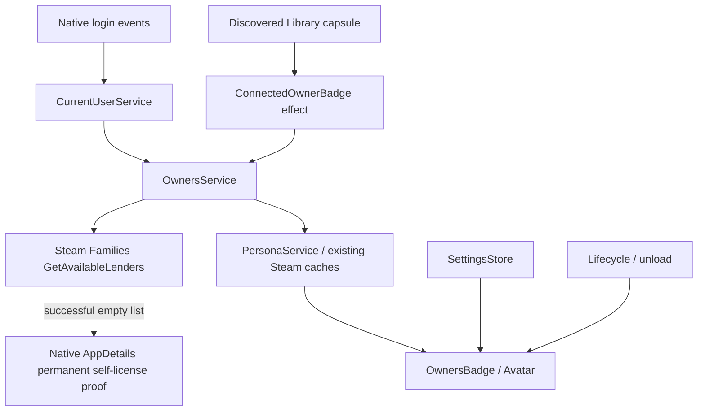

# Architecture

Family Owner runs entirely inside Decky's frontend. `src/index.tsx` composes services, installs one capsule patch and returns the plugin settings panel and teardown hook. There is no Python/backend process.

## Code map

| File | Responsibility |
| --- | --- |
| `src/steam/currentUser.ts` | Validated current account via native WebChat, asynchronous refresh and unregisterable login events. |
| `src/steam/owners.ts` | Narrow native API adapter; lender validation, deduplication, self-first ordering and permanent-license fallback. |
| `src/steam/appStore.ts` | Read-only exact AppID/app-type overview contract; never an ownership heuristic. |
| `src/services/ownersService.ts` | Request deduplication, four concurrent jobs, 256 cache/pending limit, 30-second TTL, four-second timeout, cancellation and account generations. |
| `src/steam/personas.ts` | Unique structural cache discovery; exact account/SteamID matching and validated avatar hashes. Does not populate Steam caches. |
| `src/services/personaService.ts` | Deduplicated persona requests; 256-entry cache, five-minute success/30-second fallback caching, stale-response protection. |
| `src/steam/libraryCapsule.ts` | Structural component discovery requiring unique CSS module, capsule module and memo component; no fixed webpack IDs or minified names. |
| `src/patches/libraryCapsulePatch.tsx` | Reversible supported Decky `afterPatch`; injects into the unique capsule box while preserving native children, refs and handlers. |
| `src/components/ConnectedOwnerBadge.tsx` | Effects and subscriptions outside render; validates account/app identity before exposing asynchronous results. |
| `src/components/OwnersBadge.tsx`, `Avatar.tsx` | Vertical owner stack and image fallback; reads only plugin-owned state. |
| `src/services/visibleApps.ts` | Mounted-app reference counts; one 30-second refresh timer only while capsules are mounted. |
| `src/services/lifecycle.ts` | Marks inactive and notifies mounted UI before reverse-order cleanup; continues cleanup if one callback fails. |
| `src/settings/` | Typed settings, browser storage, live subscriptions and Decky settings controls. |

## Data and safety boundaries

Only exact Steam game overviews (`app_type === 1`) are eligible. Native lender rows must match the requested AppID and contain valid account IDs. Missing/malformed/failed lists cannot prove ownership. An empty successful list may use native AppDetails only when AppID and owner SteamID match, subscribed and permanent bits are present, and borrowed/pending/expired/cancelled bits are absent. RegisterForAppDetails callbacks unregister on completion, timeout or abort.

Persona reads use existing cache `get` methods and explicit fields. Avatar URLs require a validated 40-character hexadecimal hash on the Steam avatar CDN. No native persona methods that populate caches are called. No synchronous I/O, store enumeration or library-wide ownership scan runs during React render.

Account refresh clears prior identity immediately. Generation checks reject stale identity/owner/persona responses. Unload makes lifecycle inactive before removing the capsule patch and disposing services, login subscription, settings listeners and refresh timer. Unknown or ambiguous runtime discovery leaves the native Library intact.

Discovery gates and actual fixture evidence remain in the repository's research files and progress record. They are development evidence, excluded from the install ZIP.
